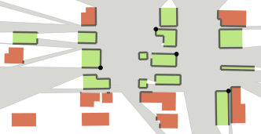

# Engineering Metaheuristics for a Visibility Coverage Problem

This repository contains the C++ solver, configuration files, and web-based solution viewer from our submission to the [GIS Cup 2026](https://sigspatial2026.sigspatial.org/giscup.html) (ACM SIGSPATIAL). It accompanies the paper

> **Engineering Metaheuristics for a Visibility Coverage Problem.**
> SIGSPATIAL ’26. https://doi.org/10.1145/3841645.3850170

Our best-found solutions are published on [Zenodo](https://doi.org/10.5281/zenodo.23055364) and can be explored in the [online viewer](https://giscup26.fe-roth.de/).

## Contents

* [Problem Description](#problem-description)
* [Repository Structure](#repository-structure)
* [Getting Started](#getting-started)
* [Running the Solver](#running-the-solver)
* [Configuration Parameters](#configuration-parameters)
* [Output Files](#output-files)
* [Reproducing the Competition Runs](#reproducing-the-competition-runs)
* [Visualization](#visualization)
* [Authors](#authors)
* [Citation](#citation)
* [Acknowledgments](#acknowledgments)
* [License](#license)

## Problem Description

The GIS Cup 2026 asked for a placement of antennas along polygon boundaries that maximizes the number of sufficiently visible polygons. The problem comes from placing 5G antennas in a city: the polygons are building footprints, and the goal is to service as many buildings as possible.

Given a set of building polygons, place exactly $k$ antennas on the polygon boundaries. A building counts as *serviced* if at least a $\tau$-fraction of its boundary length is visible from the antennas. The goal is to maximize the number of serviced buildings.

**Formal definition.** We are given a set $\mathcal{P}$ of non-overlapping polygons in the plane with boundaries $L_1, \dots, L_{|\mathcal{P}|}$, and let $\mathcal{L} := \bigcup_{i=1}^{|\mathcal{P}|} L_i$.

* For a finite set $A \subset \mathcal{L}$, a boundary point $b$ of a polygon $P \in \mathcal{P}$ is *visible* if a line segment connects $b$ to a point of $A$ without crossing the interior of any polygon $P' \in \mathcal{P}$.
* The *coverage* $C_{\mathcal{P}}(A)[P] \in [0, 1]$ of $P$ by $A$ is the visible fraction of the boundary length of $P$.
* Given a threshold $\tau \in (0, 1]$ and a number $k \in \mathbb{N}$, the goal is to find a set $A \subset \mathcal{L}$ of $|A| = k$ points, called *antennas*, that maximizes the *service score*

$$
S_{\tau,\mathcal{P}}(A) := \bigl|\{\, P \in \mathcal{P} : C_{\mathcal{P}}(A)[P] \geq \tau \,\}\bigr|.
$$

<p align="center">
  
</p>

*Example instance and solution for $\tau = 0.75$ and $k = 4$ (Figure 1 of the paper). The union of the antennas' visibility regions is shown in grey, and the visible parts of the polygon boundaries in dark grey. Serviced buildings are green; non-serviced buildings are red.*

**Instances.** The competition instance [`data/input/GIS-cup-competition-dataset.geojson`](data/input/GIS-cup-competition-dataset.geojson) has 50 000 polygons with 306 833 vertices. It was evaluated for the nine parameter combinations $\tau \in \{0.32, 0.49, 0.68\} \times k \in \{9, 49, 484\}$, with a 24-hour time window. A smaller sample instance is available in [`data/input/GIS-cup-sample-dataset.geojson`](data/input/GIS-cup-sample-dataset.geojson).

The paper describes our approach: candidate antennas at polygon vertices, local search, simulated annealing, and a dynamic data structure for fast neighbour evaluation.

## Repository Structure

```text
.
├── src/                      # Solver sources
│   ├── discrete/             # Optimization algorithms (greedy, local search, simulated annealing, ...)
│   ├── geometry/             # Visibility computation, interval sets, GeoPackage writer
│   ├── mains/                # Entry points of the executables
│   └── utility/              # k-means, solution analysis
├── include/                  # Headers and bundled header-only libraries
├── test/                     # Unit tests (googletest)
├── configs/                  # TOML configuration files for local search and simulated annealing
├── data/input/               # Sample and competition instances
├── example/                  # Example run scripts
├── external/libraries/       # Bundled CGAL and toml++, googletest submodule
├── visualization_tool/       # Web-based solution viewer
├── competition_params.toml   # Parameter file of the competition runs
├── COMPETITION_RUNS.md       # Configurations used for the competition runs
└── build_binary.sh           # Build script
```

## Getting Started

### Cloning

The project uses googletest as a git submodule. Clone the repository with its submodules:

```bash
git clone --recursive https://github.com/lbuelte/visibility-coverage-metaheuristics.git
```

or, in an existing clone, run:

```bash
git submodule update --init --recursive
```

### Dependencies

The following libraries are bundled with the repository and do not need to be installed separately:

* **CGAL 6.0.1** (`external/libraries/CGAL-6.0.1`)
* **toml++** (`external/libraries/toml++`)
* **cxxopts** (`include/jarro2783/cxxopts.hpp`, header-only)
* **JSON for Modern C++** (`include/nlohmann/json.hpp`, header-only)

The following libraries must be installed on the system:

* **Boost 1.83**
* **GDAL** (any compatible version)
* **GMP** (compatible with CGAL 6.0.1)
* **MPFR** (compatible with CGAL 6.0.1)
* **OpenMP** (any compatible version)

Standard system packages are generally sufficient for GMP and MPFR.

### Compilation

From the repository root, run the build script:

```bash
./build_binary.sh
```

It configures a release build with CMake and places the executables in the `build/` directory.

The build script compiles with **8 parallel threads** (`-j 8`). If your system has fewer threads available, lower the `-j` argument in `build_binary.sh`, for example to `-j 4`.

### Quick Start

The [`example/`](example/) directory contains two ready-to-use scripts that are run from the repository root after compilation:

* [`example/script_run_one_seeded.sh`](example/script_run_one_seeded.sh) runs `simann-ls-finish` for $k = 49$, $\tau = 0.68$ on the competition instance with four seeds in parallel.
* [`example/script_competition_run.sh`](example/script_competition_run.sh) runs the full competition cross-product as in our final runs.

Adjust the time limit or deadline, thread count, and parameters at the top of each script.

## Running the Solver

The build produces several executables for running the solver with different configurations and levels of parallelism, as well as an executable for writing solution visualizations. All executables are in the `build/` directory.

### Available Executables

| Executable                                 | Description                                                                                                                                                |
| ------------------------------------------ | ---------------------------------------------------------------------------------------------------------------------------------------------------------- |
| `GisCupBonn_RunOne`                        | Runs the solver once with the specified configuration.                                                                                                     |
| `GisCupBonn_RunOneSeededParallel`          | Runs multiple instances of a single solver configuration in parallel, each with a different random seed.                                                   |
| `GisCupBonn_RunCrossproduct`               | Evaluates the full cross-product of the specified parameters sequentially.                                                                                 |
| `GisCupBonn_RunCrossproductParallel`       | Evaluates the full cross-product of the specified parameters in parallel, using one thread per parameter combination.                                      |
| `GisCupBonn_RunCrossproductSeededParallel` | Runs multiple instances of the full cross-product in parallel, each with a different random seed.                                                          |
| `GisCupBonn_FinalSeededCrossproduct`       | Runs multiple instances of the full cross-product in parallel, each with a different random seed. This executable was used for the final competition runs. |
| `GisCupBonn_VisualizeSolutions`            | Writes visualization files for previously computed solutions (see [Visualization Output](#visualization-output)).                                          |

To display the command-line options of an executable, use its `-h` option. For example:

```bash
./build/GisCupBonn_FinalSeededCrossproduct -h
```

### Cross-Product Execution

The executables with `Crossproduct` in their names evaluate the full cross-product of the specified values of $k$ and $\tau$. Each parameter combination is one solver run and uses one thread.

`GisCupBonn_RunCrossproduct` evaluates the parameter combinations sequentially; `GisCupBonn_RunCrossproductParallel` evaluates them in parallel.

The seeded parallel executables, `GisCupBonn_RunCrossproductSeededParallel` and `GisCupBonn_FinalSeededCrossproduct`, run multiple instances of the entire cross-product concurrently, each with a different random seed. Each cross-product needs as many threads as it has parameter combinations, so the number of concurrent cross-products is

```text
floor(number of solver threads / cross-product size)
```

For example, with 9 parameter combinations and 20 solver threads, 2 cross-products run concurrently on 18 threads. The remaining 2 threads are not enough for another complete cross-product.

The same principle applies to `GisCupBonn_RunOneSeededParallel`, except that each run needs only one thread. The number of concurrent runs therefore equals the number of solver threads.

### Final Competition Executable

`GisCupBonn_FinalSeededCrossproduct` was used for the final competition runs. It needs at least **9 solver threads** (specified with `-p`) to run a complete cross-product. If `-p` is omitted or smaller than 9, the program exits without starting the solver.

```bash
./build/GisCupBonn_FinalSeededCrossproduct -p 9 <other-options>
```

## Configuration Parameters

The solver supports command-line parameters that specify the input instance, algorithm, solution parameters, runtime limits, and output options. The interface of the final competition executable differs slightly from that of the regular executables.

### Regular Executables

The regular executables (`GisCupBonn_RunOne`, `GisCupBonn_RunOneSeededParallel`, `GisCupBonn_RunCrossproduct`, `GisCupBonn_RunCrossproductParallel`, and `GisCupBonn_RunCrossproductSeededParallel`) share the same command-line interface.

#### General Parameters

| Option                             | Description                                                  | Default                                     |
| ---------------------------------- | ------------------------------------------------------------ | ------------------------------------------- |
| `-i`, `--input_path`               | Path to the input instance file.                             | `data/input/GIS-cup-sample-dataset.geojson` |
| `-o`, `--output_path`              | Path to the output directory.                                | `data/output/debug/`                        |
| `-a`, `--algo`                     | Algorithm to use.                                            | Required                                    |
| `-z`, `--time-limit`               | Time limit for each solver run, in minutes.                  | `5`                                         |
| `-s`, `--seed`, `--master_seed`    | Global seed used to initialize the random number generation. | `42`                                        |
| `-v`, `--visualize`                | Whether to write solution files for visualization.           | `false`                                     |
| `--analyse-solution`               | Whether to perform additional analysis of the solution.      | `false`                                     |
| `-p`, `--threads`, `--num_threads` | Number of threads for parallel seeded runs.                  | `1`                                         |
| `-h`, `--help`                     | Display the available command-line options.                  | —                                           |

The available algorithms are:

* `greedy`
* `greedy-boosted`
* `local-search`
* `simulated-annealing`
* `simann-ls-finish` (simulated annealing followed by local search post-processing)

#### Single-Run Configuration (`RunOne`)

`GisCupBonn_RunOne` and `GisCupBonn_RunOneSeededParallel` run the solver for a single parameter combination:

| Option                 | Description                                            | Default |
| ---------------------- | ------------------------------------------------------ | ------- |
| `-k`, `--num_antennas` | Number of antennas in the solution.                    | `100`   |
| `-t`, `--threshold`    | Coverage threshold for a building to count as covered. | `0.5`   |

For example, to run local search with 100 antennas and a coverage threshold of 0.5:

```bash
./build/GisCupBonn_RunOne \
    -i data/input/GIS-cup-sample-dataset.geojson \
    -a local-search \
    -k 100 \
    -t 0.5
```

#### Cross-Product Configuration (`RunCrossproduct`)

The cross-product executables evaluate multiple combinations of $k$ and $\tau$. The `-c` or `--crossproduct` parameter selects one of the predefined parameter sets:

| Value | Number of antennas ($k$)       | Coverage threshold ($\tau$) |
| ----- | ------------------------------ | --------------------------- |
| `0`   | No cross-product (default)     | No cross-product            |
| `1`   | `{15, 125, 250}`               | `{0.25, 0.5, 0.75}`         |
| `2`   | `{50, 500, 1000}`              | `{0.25, 0.5, 0.75}`         |
| `3`   | `{50, 500, 1000, 5000, 10000}` | `{0.25, 0.5, 0.75}`         |

Each cross-product consists of all combinations of the listed values; for example, cross-product `1` has 9 combinations. To run cross-product `1` with local search:

```bash
./build/GisCupBonn_RunCrossproduct \
    -i data/input/GIS-cup-sample-dataset.geojson \
    -a local-search \
    -c 1
```

#### Algorithm-Specific Parameters

**Local Search**

| Option                             | Description                                                                                                | Default   |
| ---------------------------------- | ---------------------------------------------------------------------------------------------------------- | --------- |
| `--ls-progress-steps`              | Progress step size for naive local search. Must be in `(0, 1]`; ideally, the value should divide 1 evenly. | `0.1`     |
| `--ls-step-iterations`             | Number of local search iterations per step in naive local search.                                          | `3`       |
| `--ls-iterations-to-local-optimum` | Number of iterations before giving up on finding a local optimum in naive local search.                    | `1000000` |

The default iteration limit is high enough that a local optimum is generally found unless the run reaches its time limit.

**Enrichment and Pruning**

| Option                        | Description                                                 | Default |
| ----------------------------- | ----------------------------------------------------------- | ------- |
| `--bisection-candidates`      | Number of candidates used for bisection enrichment.         | `0`     |
| `--multi-interval-rounds`     | Number of rounds of multi-interval enrichment.              | `0`     |
| `--polygon-pruning-threshold` | Threshold for pruning based on the number of seen polygons. | `0`     |

**Configuration Files**

Simulated annealing and local search read further parameters from TOML files in [`configs/`](configs/):

| Option                                           | Description                                         | Default                            |
| ------------------------------------------------ | --------------------------------------------------- | ---------------------------------- |
| `--sa-f`, `--sa-config`, `--simann-config`       | Path to the simulated annealing configuration file. | `configs/simann_base_config.toml`  |
| `--ls-f`, `--ls-config`, `--local-search-config` | Path to the local search configuration file.        | `configs/local_search_config.toml` |

### Final Competition Executable

`GisCupBonn_FinalSeededCrossproduct` reads the input instance and the parameter cross-product from a TOML file instead of using `-i`, `-k`, `-t`, and `-c`. For example, [`competition_params.toml`](competition_params.toml) contains:

```toml
instance_file = "data/input/GIS-cup-competition-dataset.geojson"

k = [9, 49, 484]
tau = [0.32, 0.49, 0.68]
```

The solver evaluates the full Cartesian product of the listed values of `k` and `tau`, here 9 combinations.

The executable has the following options that differ from those of the regular executables:

| Option                                                   | Description                                            | Default              |
| -------------------------------------------------------- | ------------------------------------------------------ | -------------------- |
| `-f`, `--final`, `--final_params`, `--final_params_file` | Path to the TOML parameter file.                       | Required             |
| `-d`, `--deadline`, `--time-limit-clock`                 | Absolute deadline in the format `YYYY-MM-DD HH:MM:SS`. | Required             |
| `-o`, `--output_path`                                    | Path to the output directory.                          | `data/output/final/` |

In addition, it accepts `-a`, `-s`, `-p`, `-v`, `--analyse-solution`, `-h`, and all [algorithm-specific parameters](#algorithm-specific-parameters) with the same meaning and defaults as above. The final competition runs used `simann-ls-finish` and `local-search`.

The deadline limits the execution time of all runs and is interpreted in the local timezone of the machine running the solver. For example, to run the competition parameters with `simann-ls-finish` on 18 solver threads (two concurrent cross-products):

```bash
./build/GisCupBonn_FinalSeededCrossproduct \
    -f competition_params.toml \
    -a simann-ls-finish \
    -d "2026-08-16 16:00:00" \
    -p 18
```

## Output Files

Each solver run writes several output files. The output path specified with `-o` is the root directory; the files are organized in the subdirectories `solutions/` and `logs/` (and `visualizations/` if `-v` is set).

Each run gets a unique identifier based on the instance name, the parameter values, the machine thread, the current date and time, and a random component:

```text
<instance_name>_par_<k>_<tau>_id_<timestamp>_<random>
```

The solution identifier extends the run identifier with the number of serviced polygons:

```text
<run_identifier>_val_<number_of_serviced_polygons>
```

### Solutions

The `solutions/` directory contains the final solution of each run:

* `<solution_identifier>.solution.giscup`
* `<solution_identifier>.solution.ids`

The `.solution.giscup` file contains the solution in the GIS Cup format:

1. The parameter pair $(\tau, k)$.
2. A comma-separated list of the $k$ antenna coordinates.
3. A comma-separated list of the IDs of the buildings claimed to be serviced.

The `.solution.ids` file contains the antenna IDs and serviced polygon IDs in a human-readable format:

```text
Solution antenna IDs:
...

Serviced polygon IDs:
...
```

### Logs

The `logs/` directory contains the configuration, log output, and backup solutions of each run:

* `<run_identifier>.config.log`: the configuration used for the run.
* `<run_identifier>.ls.log`: the log output of the local search procedure.
* `<run_identifier>.simann.log`: the log output of the simulated annealing procedure.
* `<run_identifier>_val_<n>.ls.sol`: the best solution found by local search, in GIS Cup format.
* `<run_identifier>_val_<n>.simann.sol`: the best solution found by simulated annealing, in GIS Cup format.

The `.ls.sol` and `.simann.sol` files are backups that preserve the best solutions found by each procedure.

### Visualization Output

With `-v`, the solver also writes the solution as GeoPackage files to

```text
<output_path>/visualizations/<solution_identifier>.solution.visualization/
├── antenna_positions.gpkg
├── covered_polygons_with_coverage.gpkg
├── uncovered_polygons_with_coverage.gpkg
├── union_edges.gpkg
└── union_visibility.gpkg
```

This is the layout the [web viewer](#visualization) expects.

For runs without `-v`, `GisCupBonn_VisualizeSolutions` computes these files afterwards from the `.solution.ids` files in `<output_path>/solutions/` that match the given instance, $k$, and $\tau$:

```bash
./build/GisCupBonn_VisualizeSolutions \
    -i data/input/GIS-cup-competition-dataset.geojson \
    -o data/output/final \
    -k 49 \
    -t 0.68
```

Always pass `-i` explicitly, because the default input path does not exist in this repository. The output uses the same `visualizations/` layout as `-v`.

## Reproducing the Competition Runs

[`COMPETITION_RUNS.md`](COMPETITION_RUNS.md) lists the configurations used for the competition: the algorithm, seed, configuration file, and pruning setting of each run. All runs used `GisCupBonn_FinalSeededCrossproduct` with [`competition_params.toml`](competition_params.toml) and 90 solver threads per compute node. [`example/script_competition_run.sh`](example/script_competition_run.sh) is a template for such a run.

## Visualization

### Solution Data

Visualization data for our best-found GIS Cup 2026 solutions for each $(\tau, k)$ combination is available on Zenodo (CC BY 4.0):

> Bülte, L., Faber, D., Kaibel, M., Kolbe, B., Mayer, P., Müller, L., Mutzel, P., & Roth, F. (2026).
> GIS Cup 2026 Solution Visualizations for 'Engineering Metaheuristics for a Visibility Coverage Problem' [Graphic].
> Zenodo.
> https://doi.org/10.5281/zenodo.23055364

### Web Viewer

[`visualization_tool/`](visualization_tool/) contains an interactive web application (FastAPI and Leaflet) for exploring solutions. It shows antenna positions, covered and uncovered buildings, visible edges, visibility regions, and coverage labels. It can overlay two solutions for comparison and shows a statistics table over all algorithms and parameter combinations.

A hosted instance with our competition solutions is available at **https://giscup26.fe-roth.de/**.

To run the viewer locally (Python 3.11 or newer):

```bash
cd visualization_tool
python3 -m venv .venv
source .venv/bin/activate
python -m pip install -r requirements.txt
python scripts/download_zenodo_data.py   # optional: fetch our published solutions
python app.py --host 127.0.0.1 --port 8000
```

Then open <http://127.0.0.1:8000>. Instead of downloading the Zenodo data, you can link the viewer's `data/` folder to the solver's `data/` folder so that all solver output is directly available. See [`visualization_tool/README.md`](visualization_tool/README.md) for configuration, the expected directory layout, caching, and deployment with Docker.

## Authors

* Laura Bülte
* Daniel Faber
* Michael Kaibel
* Benedikt Kolbe
* Philip Mayer
* Lars Müller
* Petra Mutzel
* Felix Roth

All authors are with the University of Bonn, Germany.

## Citation

If you use this code in your research, please cite the associated paper:

> Laura Bülte, Daniel Faber, Michael Kaibel, Benedikt Kolbe, Philip Mayer, Lars Müller, Petra Mutzel, and Felix Roth.
> **Engineering Metaheuristics for a Visibility Coverage Problem.**
> In *Proceedings of the 34th ACM International Conference on Advances in Geographic Information Systems (SIGSPATIAL ’26)*, November 3–6, 2026, Riverside, CA, USA. ACM, New York, NY, USA, 4 pages.
> https://doi.org/10.1145/3841645.3850170

```bibtex
@inproceedings{buelte2026metaheuristics,
  author    = {B{\"u}lte, Laura and Faber, Daniel and Kaibel, Michael and Kolbe, Benedikt and
               Mayer, Philip and M{\"u}ller, Lars and Mutzel, Petra and Roth, Felix},
  title     = {Engineering Metaheuristics for a Visibility Coverage Problem},
  booktitle = {Proceedings of the 34th ACM International Conference on Advances in
               Geographic Information Systems (SIGSPATIAL '26)},
  year      = {2026},
  address   = {Riverside, CA, USA},
  publisher = {ACM},
  doi       = {10.1145/3841645.3850170}
}
```

## Acknowledgments

This work was supported by the German Research Foundation (DFG) under grant number 459420781. We gratefully acknowledge access to the Marvin cluster of the University of Bonn.

## License

All code in this repository is licensed under the MIT License (see [`LICENSE`](LICENSE)), except for the following bundled third-party components, which are subject to their own licenses (see their respective license files):

* CGAL (`external/libraries/CGAL-6.0.1`)
* toml++ (`external/libraries/toml++`)
* cxxopts (`include/jarro2783/cxxopts.hpp`)
* JSON for Modern C++ (`include/nlohmann/json.hpp`)
* Leaflet (`visualization_tool/static/vendor/leaflet`, BSD 2-Clause)
* googletest (git submodule, `external/libraries/googletest`)

The input instances in `data/input/` are provided by Microsoft under the Community Data License Agreement – Permissive – Version 2.0 (see [`data/input/LICENSE`](data/input/LICENSE)).
